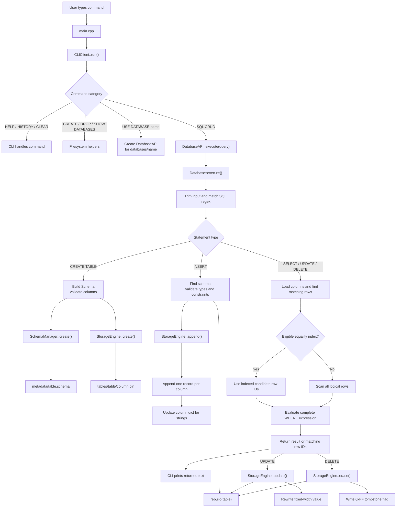
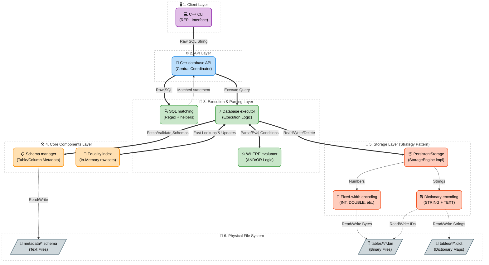
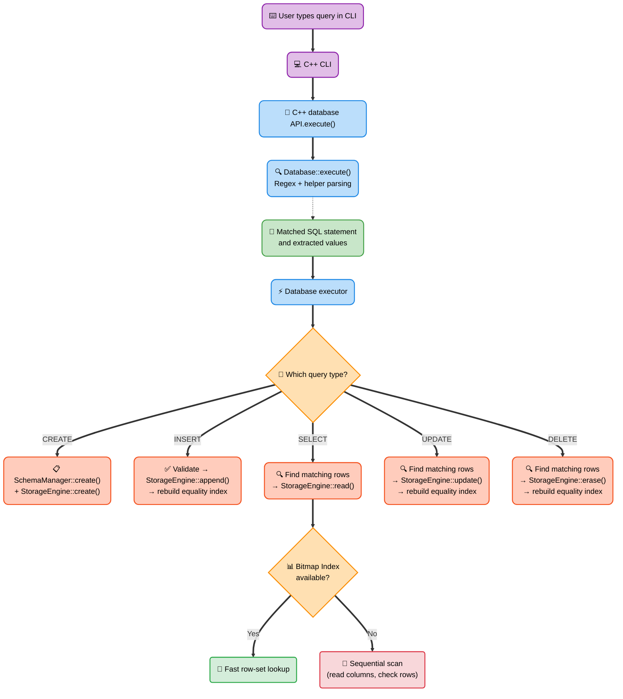
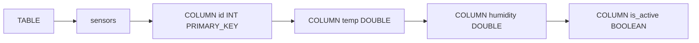
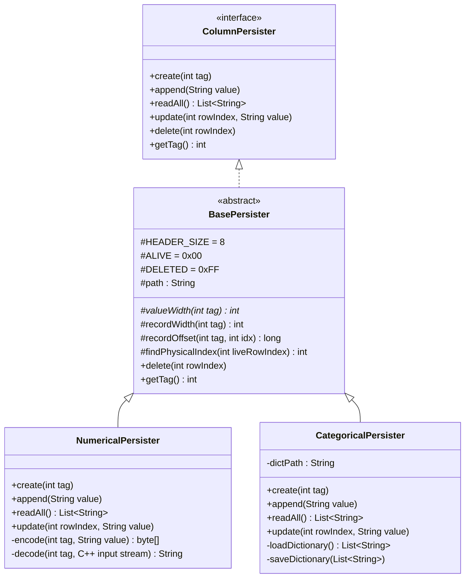
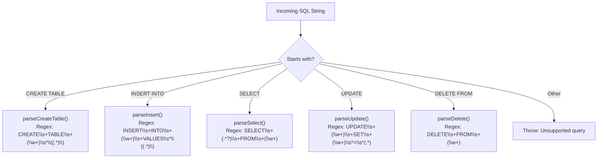
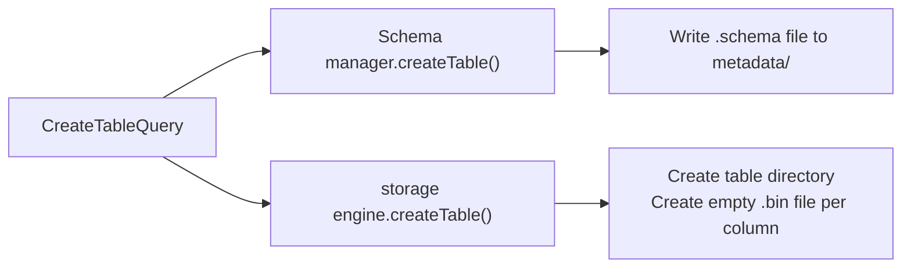
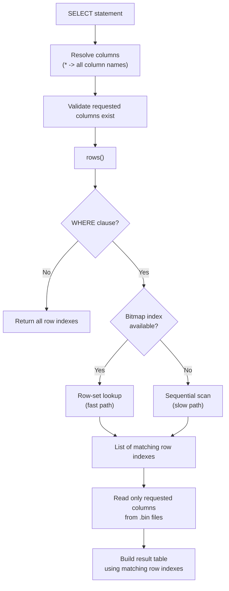
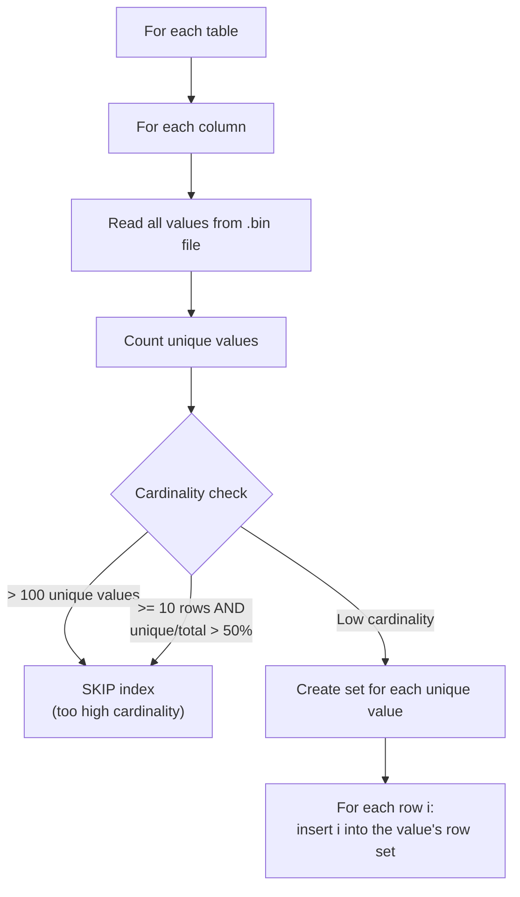

# 🎓 Column-Store Database — Complete Viva Preparation Guide

> **Project**: Column-Store Data Storage System
> **Language**: C++17 (standard library only)
> **Entry Point**: `cdb_cpp/main.cpp` (`cdb_cli`)

## C++ migration

The database engine is implemented in C++17 under [`cdb_cpp/`](D:/CDB-C++/cdb_cpp).
The implementation preserves the existing schema and column-file layout, including
the big-endian binary headers, tombstone records, and categorical dictionaries, so
the bundled [`databases/`](D:/CDB-C++/databases) directory can be opened by the C++
engine.

### Build and run

Use CMake with a C++17-capable compiler:

```powershell
cmake -S cdb_cpp -B build
cmake --build build --config Release
.\build\Release\cdb_cli.exe databases
```

The optional command-line argument is the root directory containing database
directories. When no argument is supplied, the executable searches both
`databases/` and `../databases/`, so it works when launched from either the
repository root or `cdb_cpp/`. The CLI accepts commands with or without a
trailing semicolon and supports database selection, table inspection,
bitmap-index inspection, and `CREATE TABLE`, `INSERT`, `SELECT`, `UPDATE`, and
`DELETE` SQL commands. Type `HELP` at the prompt for the available commands.

The repository is C++-only. The runnable implementation is the C++ target in
`cdb_cpp/`; no external language runtime or compiler is required at runtime.

### Java feature parity

The C++ edition supports the core behavior of the former implementation:

| Area | C++ behavior |
|---|---|
| SQL | `CREATE TABLE`, `INSERT`, `SELECT`, `UPDATE`, `DELETE`, and `DROP TABLE` |
| Filtering | Comparisons, nested parentheses, `AND`/`OR`, and precedence-aware evaluation |
| Storage | Typed fixed-width binary columns, dictionaries, and tombstone deletion |
| Constraints | `NOT_NULL`, `PRIMARY_KEY`, and `UNIQUE` validation before writes |
| Indexing | Low-cardinality categorical indexes used to narrow equality filters |
| CLI | `HISTORY`, `!n` command recall, `CLEAR`, `SHOW` commands, and `DROP DATABASE` |

---

## Table of Contents

1. [What is a Column-Store Database?](#1-what-is-a-column-store-database)
2. [Project Architecture — The Big Picture](#2-project-architecture--the-big-picture)
3. [Package & File Map](#3-package--file-map)
4. [Schema Layer (DDL)](#4-schema-layer-ddl)
5. [Storage Layer — Binary Column Files](#5-storage-layer--binary-column-files)
6. [Query Parser](#6-query-parser--how-queries-are-understood)
7. [Query Engine — Execution](#7-query-engine--execution)
8. [WHERE Clause & AND/OR Logic](#8-where-clause--andor-logic)
9. [Bitmap Indexing](#9-bitmap-indexing)
10. [CLI Client](#10-cli-client)
11. [Utility & Testing](#11-utility--testing)
12. [Sample Demonstrations](#12-sample-demonstrations)
13. [Likely Viva Questions & Answers](#13-likely-viva-questions--answers)

---

## 1. What is a Column-Store Database?

### Row-Store (Traditional) vs Column-Store

In a **row-store** database (like MySQL), one row of data is stored together:

```
Row 1:  [1, "Alice", "Engineering", 80000]
Row 2:  [2, "Bob",   "HR",          50000]
Row 3:  [3, "Charlie","Engineering", 90000]
```

In a **column-store** database (like this project), each **column** is stored in its own separate file:

```
id.bin:      [1, 2, 3]
name.bin:    ["Alice", "Bob", "Charlie"]
dept.bin:    ["Engineering", "HR", "Engineering"]
salary.bin:  [80000, 50000, 90000]
```

### Why Column-Store?

| Advantage | Explanation |
|-----------|-------------|
| **Fast analytical queries** | The column-oriented layout keeps each column in its own file and provides a clear path for projection pushdown; the current executor loads table columns for row evaluation |
| **Better compression** | Same data type in a file compresses much better (e.g., a column of integers) |
| **Bitmap indexing fits naturally** | Since each column is separate, creating per-column indexes is straightforward |
| **Reduced I/O potential** | Separate column files allow storage and query optimizations; the current row evaluator may load additional columns needed by predicates |

> [!IMPORTANT]
> **Key takeaway for viva**: Column-stores are optimized for *reading specific columns* across many rows (analytical workloads), while row-stores are optimized for *reading/writing entire rows* (transactional workloads).

---

## 2. Project Architecture — The Big Picture

### 2.1 Actual request-to-filesystem flow

The following diagram describes the current C++ implementation. The CLI
handles session commands such as `USE DATABASE`, while SQL statements are
delegated through the API to `Database`, which coordinates schemas, indexes,
storage, and the filesystem.



### 2.2 Step-by-step execution

#### Step 1: Process startup

1. [`main.cpp`](D:/CDB-C++/cdb_cpp/main.cpp) chooses the database root from
   the command-line argument, `databases/`, or `../databases/`.
2. It creates [`CLIClient`](D:/CDB-C++/cdb_cpp/client/cli.hpp), then starts
   the interactive read-evaluate-print loop.
3. The CLI handles non-SQL commands itself. For example, `CREATE DATABASE`
   creates a directory and `USE DATABASE company_db` selects a database path.

#### Step 2: Database selection

When `USE DATABASE company_db` is entered, the CLI constructs
[`DatabaseAPI`](D:/CDB-C++/cdb_cpp/api/database_api.hpp) with
`databases/company_db`. The API constructs `Database`, which:

1. Loads schema metadata through `SchemaManager`.
2. Selects `PersistentStorage` as the default `StorageEngine`.
3. Creates the `tables/` directory if necessary.
4. Rebuilds eligible in-memory equality indexes for existing tables.

Indexes are not persisted as separate files. They are rebuilt when the
database object starts and after table modifications.

#### Step 3: SQL parsing and dispatch

For SQL input, `CLIClient` calls `DatabaseAPI::execute(query)`. The request
then follows this path:

```text
CLIClient
  -> DatabaseAPI::execute()
    -> Database::execute()
      -> trim input and remove optional semicolon
      -> match CREATE, INSERT, SELECT, UPDATE, DELETE, or DROP regex
      -> validate and execute the selected operation
      -> return a text result or "Error: ..."
```

The parser is currently implemented inside `Database::execute()` using
regular expressions and helper functions such as `split_csv()`,
`parseWhere()`, and `evaluateWhere()`. It does not create separate parser
objects for each statement.

#### Step 4: CREATE TABLE

For:

```sql
CREATE TABLE employees (id INT, name TEXT, salary DOUBLE);
```

the engine:

1. Extracts the table name and column definitions.
2. Builds a `Schema` containing `Column` objects and constraints.
3. Rejects duplicate or invalid table definitions.
4. Writes the schema to `metadata/employees.schema`.
5. Calls `StorageEngine::create()` to create one `.bin` file per column.
6. Creates an empty `.dict` file for string-like columns.

#### Step 5: INSERT

For:

```sql
INSERT INTO employees VALUES (1, 'Alice', 75000);
```

the engine:

1. Finds the table schema.
2. Checks that the value count matches the column count.
3. Enforces `NOT_NULL`, `PRIMARY_KEY`, and `UNIQUE`.
4. Validates each value against its declared type.
5. Calls `StorageEngine::append()` once for each column.
6. Updates the dictionary when a string value is new.
7. Rebuilds the table's in-memory equality indexes.

#### Step 6: SELECT and WHERE evaluation

For:

```sql
SELECT name, salary FROM employees WHERE department = 'Engineering';
```

the engine:

1. Loads the schema and reads the table's column vectors for row evaluation.
2. Determines the logical row count from those loaded columns.
3. Uses an eligible equality index to produce candidate row IDs when
   possible.
4. Falls back to all rows when no index applies.
5. Evaluates the complete `WHERE` expression, including comparisons,
   parentheses, `AND`, and `OR`.
6. Formats only the requested columns as tab-separated output. The current
   row evaluator may load additional table columns to evaluate predicates.

The current index is an in-memory inverted index backed by `std::set<int>`
row IDs. It is not a persisted bit-vector bitmap. It is created only for
categorical, low-cardinality columns. `AND` intersects candidate sets and
`OR` unions them; non-indexed predicates use a sequential scan.

#### Step 7: UPDATE and DELETE

`UPDATE` first uses the same row-selection path as `SELECT`, validates the
replacement value, and calls `StorageEngine::update()` for each matching
logical row. The persistent backend maps the logical row to its physical
record and rewrites the fixed-width value.

`DELETE` also finds matching logical rows, then calls
`StorageEngine::erase()` for every column. The backend writes `0xFF` to the
record flag instead of shifting later records. This is a tombstone delete:
future reads skip the deleted record while its bytes remain in the file.
Indexes are rebuilt after both operations.

### 2.3 Filesystem result

For `company_db` and an `employees` table, the request ultimately produces:

```text
databases/
└── company_db/
    ├── metadata/
    │   └── employees.schema
    └── tables/
        └── employees/
            ├── id.bin
            ├── name.bin
            ├── name.dict
            ├── department.bin
            ├── department.dict
            └── salary.bin
```

The `.schema` file stores table metadata as text. Each column has its own
`.bin` file, which is the defining column-store behavior. Numeric and boolean
values are stored as fixed-width binary values. String-like values are stored
as dictionary IDs in `.bin`, with the original strings in `.dict`.

### 2.4 Layered architecture overview

This diagram shows the layered architecture of the entire system, from the user interface down to the physical file system:



### 2.5 Query execution summary

Here is the complete flow of how a query travels through the system:



### C++ implementation layers

| Package | Responsibility |
|---------|---------------|
| `cdb_cpp/main.cpp` | C++ command-line entry point |
| `cdb_cpp/cdb.hpp` | Storage engine contract, persistent storage, parser, executor, indexes, and shell |
| `cdb_cpp/api/database_api.hpp` | Database API facade |
| `cdb_cpp/client/cli.hpp` | Interactive CLI and command routing |
| `cdb_cpp/ddl/schema.hpp` | Column, table, and schema manager interfaces |
| `cdb_cpp/query/query.hpp` | Query engine and WHERE abstractions |
| `cdb_cpp/query/querytypes/` | Select, insert, update, and delete query models |
| `cdb_cpp/storage/storage.hpp` | Public storage-engine aliases and persistent implementation |
| `cdb_cpp/storage/persistence/` | Column persistence contracts |
| `cdb_cpp/util/filesystem.hpp` | Filesystem utility interface |
| `cdb_cpp/CMakeLists.txt` | C++17 build configuration |
| `databases/` | Schema metadata, column files, and dictionaries |

---

## 3. Package & File Map

```
Column-Store-Data-Storage-System/
├── cdb_cpp/
│   ├── main.cpp                      ← C++ command-line interface
│   ├── cdb.hpp                       ← Shared storage/query implementation
│   ├── api/database_api.hpp          ← Database API layer
│   ├── client/cli.hpp                ← CLI layer
│   ├── ddl/schema.hpp                ← Schema layer
│   ├── query/
│   │   ├── query.hpp                 ← Query layer
│   │   └── querytypes/               ← Query model types
│   ├── storage/
│   │   ├── storage.hpp               ← Storage layer
│   │   └── persistence/              ← Column persistence contracts
│   ├── util/filesystem.hpp           ← Utility layer
│   └── CMakeLists.txt                ← C++17 build definition
├── databases/                        ← Persistent database files
└── Reference/                        ← Storage and query design notes
└── databases/
    └── company_db/
        ├── metadata/
        │   ├── employees.schema      ← Schema definition file
        │   └── products.schema       ← Schema definition file
        └── tables/
            ├── employees/
            │   ├── department.bin    ← STRING column (binary, dict encoded)
            │   ├── department.dict   ← Dictionary for department
            │   ├── id.bin            ← INT column (binary)
            │   ├── is_active.bin     ← BOOLEAN column (binary)
            │   ├── name.bin          ← STRING column (binary, dict encoded)
            │   ├── name.dict         ← Dictionary for name
            │   └── salary.bin        ← DOUBLE column (binary)
            └── products/
                ├── category.bin      ← STRING column (binary, dict encoded)
                ├── category.dict     ← Dictionary for category
                ├── pid.bin           ← INT column (binary)
                ├── pname.bin         ← STRING column (binary, dict encoded)
                ├── pname.dict        ← Dictionary for pname
                ├── price.bin         ← FLOAT column (binary)
                └── stock.bin         ← SHORT column (binary)
```

---

## 4. Schema Layer (DDL)

### What the Schema Layer Does

The schema layer is responsible for **defining the structure** of tables — what columns exist, what types they are, and what constraints they have. It is NOT responsible for actual data storage.

### Files Involved

#### `Column schema implementation` — Represents ONE Column


Think of it as a blueprint for a single column. It knows:
- The column's **name** (e.g., `id`, `name`, `salary`)
- The column's **data type** (e.g., `INT`, `STRING`, `DOUBLE`)
- Any **constraints** (e.g., `PRIMARY_KEY`, `UNIQUE`, `NOT_NULL`)

#### `C++ table schema` — Represents ONE Table


A `Table schema` is simply a list of `Column schema` objects grouped under a table name.

#### `Schema manager implementation` — Manages All Schemas

This is the **controller** for all schema operations:

1. **On startup** → Scans the `metadata/` folder for `.schema` files and loads them into a `HashMap<String, Table schema>`
2. **On CREATE TABLE** → Serializes the schema into a `.schema` file and saves it to disk
3. **On demand** → Provides `getTable(name)` to look up a table's structure

### Schema File Format

Schemas are stored as plain text in the `metadata/` directory:

```
TABLE sensors COLUMN id INT PRIMARY_KEY COLUMN temp DOUBLE COLUMN humidity DOUBLE COLUMN is_active BOOLEAN
```

**Parsing logic** (in `parseSchemaString()`):
1. Split the text by whitespace
2. First token must be `TABLE`, second is the table name
3. Every time you hit `COLUMN`, the next two tokens are column name and type
4. Any tokens after those two (until the next `COLUMN`) are constraints



> [!TIP]
> **For viva**: Schema files are the "blueprint" — they tell the system what structure a table should have. The actual data lives separately in `.bin` files.

---

## 5. Storage Layer — Binary Column Files

### The Interface Pattern

The runnable implementation uses `StorageEngine` and `PersistentStorage`
directly. The persister class diagram below is a conceptual description of
type-specific encoding responsibilities; the current C++ source keeps those
encoding routines inside `PersistentStorage`.

The project uses the **Strategy Pattern**: `cdb::StorageEngine` defines the
storage contract, while `cdb::PersistentStorage` implements the existing
typed binary-column format. `cdb::Database` receives a
`std::unique_ptr<cdb::StorageEngine>`, so another implementation can be
provided without changing SQL parsing or execution.

The persistent implementation is also exposed as
`cdb::storage::PersistentStorageEngine` (with
`cdb::storage::BinaryStorageEngine` retained as a compatibility alias):

```cpp
#include "api/database_api.hpp"
#include "storage/storage.hpp"

cdb::api::DatabaseAPI api(
    "databases/company_db",
    std::make_unique<cdb::storage::PersistentStorageEngine>(
        "databases/company_db"));
```


> [!NOTE]
> This design means you could easily swap in a different storage implementation (e.g., text-based, compressed, etc.) without changing any other code. This is a key OOP design principle — **programming to an interface**.

### Binary File Format

Each column is stored as a **single `.bin` file**. The file format:

```
┌──────────────────────────────────────────┐
│ HEADER (8 bytes)                         │
│   ├── Type Tag (4 bytes, int)            │  ← What data type? (INT=3, DOUBLE=6, STRING=9, etc.)
│   └── Record Count (4 bytes, int)        │  ← Total number of records (including deleted)
├──────────────────────────────────────────┤
│ RECORD 0                                 │
│   ├── Flag (1 byte)                      │  ← 0x00 = ALIVE, 0xFF = DELETED (tombstone)
│   └── Value (N bytes, type-dependent)    │  ← The actual data
├──────────────────────────────────────────┤
│ RECORD 1                                 │
│   ├── Flag (1 byte)                      │
│   └── Value (N bytes)                    │
├──────────────────────────────────────────┤
│ ...                                      │
└──────────────────────────────────────────┘
```

### The Type Tag System

| Type Tag | SQL Type | Width (bytes) | C++ representation |
|----------|----------|---------------|-----------|
| 1 | BYTE | 1 | `byte` |
| 2 | SHORT | 2 | `short` |
| 3 | INT / INTEGER | 4 | `int` |
| 4 | LONG / BIGINT | 8 | `long` |
| 5 | FLOAT / REAL | 4 | `float` |
| 6 | DOUBLE / DECIMAL | 8 | `double` |
| 7 | BOOLEAN / BOOL | 1 | `byte` (0 or 1) |
| 8 | BIGDECIMAL / NUMERIC | 20 | `BigDecimal` |
| 9 | STRING / VARCHAR / TEXT | 4 | Dictionary ID (`int`) |

### The Persister Hierarchy



### NumericalPersister — How Numbers Are Stored

For numeric types (INT, DOUBLE, FLOAT, etc.), the values are directly written as **raw binary bytes**.

**Example**: Storing `[42, 99, 7]` in an INT column:

```
Bytes: [00 00 00 03] [00 00 00 03]  ← Header: tag=3 (INT), count=3
       [00] [00 00 00 2A]           ← Record 0: ALIVE, value=42
       [00] [00 00 00 63]           ← Record 1: ALIVE, value=99
       [00] [00 00 00 07]           ← Record 2: ALIVE, value=7
```

- **Encode**: Converts a `String` value like `"42"` → parses it to an `int` → writes 4 bytes using `C++ output stream`
- **Decode**: Reads 4 bytes using `C++ input stream.readInt()` → converts back to `String`

### CategoricalPersister — How Strings Are Stored (Dictionary Encoding)

Strings are NOT stored directly in the `.bin` file. Instead, the system uses **dictionary encoding**:

1. A separate **dictionary file** (`.dict`) maps each unique string to a numeric ID
2. The `.bin` file stores only the **4-byte integer IDs**

**Example**: Storing `["Engineering", "HR", "Engineering"]`:

**Dictionary file** (`dept.dict`):
```
0 → "Engineering"
1 → "HR"
```

**Binary file** (`dept.bin`):
```
Bytes: [00 00 00 09] [00 00 00 03]  ← Header: tag=9 (STRING), count=3
       [00] [00 00 00 00]           ← Record 0: ALIVE, dict_id=0 → "Engineering"
       [00] [00 00 00 01]           ← Record 1: ALIVE, dict_id=1 → "HR"
       [00] [00 00 00 00]           ← Record 2: ALIVE, dict_id=0 → "Engineering"
```

> [!TIP]
> **Why dictionary encoding?** If "Engineering" appears 1000 times, instead of storing the full string 1000 times, we store the 4-byte ID `0` 1000 times. This saves massive space and makes the column fixed-width so random access is possible.

### The Tombstone Delete Mechanism

When a row is deleted, the system does **NOT** physically remove the bytes from the file. Instead:

1. It finds the physical record position
2. Changes the 1-byte flag from `ALIVE (0x00)` to `DELETED (0xFF)`
3. On `readAll()`, deleted records are automatically **skipped**

```
Before delete:    [00] [00 00 00 2A]   ← ALIVE, value=42
After delete:     [FF] [00 00 00 2A]   ← DELETED (tombstone), value still there but ignored
```

### The Physical Index vs Logical Index Problem

Because of tombstone deletion, there's a gap between:
- **Logical index**: What the user sees (row 0, 1, 2, ...)
- **Physical index**: Actual byte position in the file

The `findPhysicalIndex(int liveRowIndex)` method in `BasePersister` handles this by scanning from the start, counting only ALIVE records until it reaches the requested logical index.

```
Physical:  [ALIVE] [DELETED] [ALIVE] [ALIVE] [DELETED] [ALIVE]
Logical:      0       -        1        2       -        3
```

---

## 6. Query Parser — How Queries Are Understood

In the current implementation, parsing is performed inside
`Database::execute()` using regular expressions and helper functions. The
query-object examples in this section are illustrative descriptions of the
information extracted from SQL, not classes present in the runnable source.

### What the Parser Does

The `Query parser` takes a raw SQL string and converts it into a structured **Query object** that the engine can execute.

```
"SELECT name, salary FROM employees WHERE dept = 'HR'"
                        ↓ Query parser.parse()
SelectQuery {
    tableName: "employees",
    columns: ["name", "salary"],
    whereClause: WhereClause {
        conditions: [WhereCondition("dept", "=", "HR")],
        logicalOp: AND
    }
}
```

### Parsing Strategy

The parser uses **regex (regular expressions)** and **string splitting**:



### How the WHERE Clause is Parsed

This happens in two steps:

**Step 1: `splitWhereClause()`** — Splits the query at the `WHERE` keyword:
```
"SELECT * FROM emp WHERE salary > 50000"
   → mainPart: "SELECT * FROM emp"
   → whereStr: "salary > 50000"
```

**Step 2: `parseWhereClause()`** — Parses the WHERE string:
1. Check if the string contains `AND` or `OR` keywords
2. Split the string on that keyword to get individual conditions
3. For each condition, use the regex `(\w+)\s*(>=|<=|!=|[=><])\s*(.+)` to extract column, operator, and value
4. Return a `WhereClause` object containing a list of `WhereCondition` objects

**Example with AND**:
```
"salary > 50000 AND dept = 'HR'"
   → Split on AND → ["salary > 50000", "dept = 'HR'"]
   → WhereCondition("salary", ">", "50000")
   → WhereCondition("dept", "=", "HR")
   → WhereClause(conditions=[...], logicalOp=AND)
```

### Supported Operators

| Operator | Meaning |
|----------|---------|
| `=` | Equal to |
| `!=` | Not equal to |
| `>` | Greater than |
| `<` | Less than |
| `>=` | Greater than or equal to |
| `<=` | Less than or equal to |

---

## 7. Query Engine — Execution

The query execution logic is implemented by `Database::execute()` in
`cdb_cpp/cdb.hpp`; it receives a raw SQL string, matches it with regular
expressions, and performs the operation directly. The diagrams below are
conceptual summaries of that implementation, not separate query-object
classes.

### CREATE TABLE Execution



1. `Schema manager.createTable()` → serializes `Table schema` to a `.schema` file in `metadata/`
2. `Binary storage engine.createTable()` → creates a directory for the table under `tables/`, and for each column, creates an empty `.bin` file with just the 8-byte header (type tag + count=0)

### INSERT Execution

```mermaid
flowchart TD
    A["INSERT statement"] --> B["Get table schema"]
    B --> C["Validate: column count match?"]
    C --> D["For each column:"]
    D --> E["Check NOT_NULL constraint"]
    D --> F["Validate data type"]
    D --> G["Check PRIMARY_KEY / UNIQUE"]
    G --> H["Read existing column values\nCheck for duplicate"]
    H --> I["All validations passed?"]
    I -->|Yes|     J["For each column:\nStorageEngine::append()"]
    J --> K["Rebuild in-memory equality index"]
    I -->|No| L["Throw Error"]
```

**Key detail**: Validation happens **before any writes**. This ensures atomicity — either all columns get the new value, or none do.

### SELECT Execution



### UPDATE Execution

1. Find matching rows using `rows()` (same WHERE logic as SELECT)
2. For each matching row:
   - Call `StorageEngine::update()` -> overwrites the value at that physical record
   - Rebuild the table's in-memory equality index

### DELETE Execution

1. Find matching rows using `rows()`
2. Delete rows **from bottom to top** so logical row references remain valid
3. For each row, call `StorageEngine::erase()` to set the tombstone flag
   (`0xFF`) across all column files
4. Rebuild the table's in-memory equality index

> [!IMPORTANT]
> **Why delete from bottom to top?** If you delete row 2 first, then row 5 becomes row 4 (because a live row is removed). By deleting from the highest index downward, earlier indexes remain valid until you process them.

---

## 8. WHERE Clause & AND/OR Logic

### Data Classes

```
WhereCondition: Represents ONE condition like "salary > 50000"
    - column: "salary"
    - op: ">"
    - value: "50000"

WhereClause: Represents the FULL WHERE clause
    - conditions: [WhereCondition, WhereCondition, ...]
    - logicalOp: AND or OR
```

### How Conditions Are Evaluated

The `evaluateCondition()` method in `Query engine`:

1. **Try numeric comparison first**: Parse both values as `double`, then use `==`, `!=`, `>`, `<`, `>=`, `<=`
2. **Fall back to string comparison**: If parsing fails (not a number), use `equalsIgnoreCase()` for `=` and `!=`


### AND Logic (Step by Step)

Query: `SELECT * FROM emp WHERE dept = 'HR' AND salary > 50000`

Row-by-row evaluation with short-circuit:

| Row | dept | salary | `dept='HR'` | `salary>50000` | AND Result |
|-----|------|--------|------------|----------------|------------|
| 0 | Engineering | 80000 | ❌ | — (short-circuited) | ❌ |
| 1 | HR | 50000 | ✅ | ❌ | ❌ |
| 2 | HR | 55000 | ✅ | ✅ | ✅ |
| 3 | Finance | 75000 | ❌ | — (short-circuited) | ❌ |

**AND short-circuit**: As soon as one condition is `false`, skip the rest (result is already `false`).

### OR Logic (Step by Step)

Query: `SELECT * FROM emp WHERE dept = 'Finance' OR name = 'Alice'`

| Row | dept | name | `dept='Finance'` | `name='Alice'` | OR Result |
|-----|------|------|------------------|----------------|-----------|
| 0 | Engineering | Alice | ❌ | ✅ | ✅ |
| 1 | HR | Bob | ❌ | ❌ | ❌ |
| 2 | Engineering | Charlie | ❌ | ❌ | ❌ |
| 3 | Finance | David | ✅ | — (short-circuited) | ✅ |

**OR short-circuit**: As soon as one condition is `true`, skip the rest (result is already `true`).

---

## 9. Bitmap Indexing

### Current index implementation

The current C++ implementation does not use a persisted bit-vector bitmap.
It uses an in-memory inverted index:

```cpp
std::map<table, std::map<column,
    std::map<value, std::set<int>>>>
```

Each value maps to a set of logical row IDs. The index is used for simple
equality predicates and is rebuilt on startup and after writes. `SHOW BITMAP
INDEX` is retained as the CLI command name for compatibility, but it displays
these row sets.

### What a bitmap index would be

A bitmap index is a **data structure that maps each unique value in a column to a bit-vector** (array of 0s and 1s), where each bit represents one row.

**Example** — Column `dept` with 5 rows: `[Engineering, HR, Engineering, Finance, HR]`

```
Value "Engineering" → BitSet: 1 0 1 0 0
Value "HR"          → BitSet: 0 1 0 0 1
Value "Finance"     → BitSet: 0 0 0 1 0
```

### In-Memory Structure


### How the current equality index is built (`rebuild()`)



### Cardinality Threshold — Why Skip High-Cardinality Columns?

> [!WARNING]
> A bitmap index works best for **low-cardinality** columns (columns with few unique values — like `dept` with 5 departments).
>
> For **high-cardinality** columns (like `id` with thousands of unique values), the bitmap index wastes memory because you'd have thousands of BitSets, each with mostly 0s.

**The rules**:
- If **unique values > 100** -> Skip the index
- If **rows ≥ 10** AND **unique/total > 50%** -> Skip the index

This check happens:
1. During initial `rebuild()` at startup
2. After `INSERT`, `UPDATE`, and `DELETE`, when the table is rebuilt

### How Bitmap Index Speeds Up Queries

**Without index** (Sequential Scan):
```
Query: SELECT * FROM emp WHERE dept = 'HR'
Step 1: Read ALL values from dept.bin → [Eng, HR, Eng, Fin, HR]
Step 2: Check each value: row 0? No. row 1? Yes. row 2? No. row 3? No. row 4? Yes.
Step 3: Result rows: [1, 4]
```

**With index** (row-set lookup):
```
Query: SELECT * FROM emp WHERE dept = 'HR'
Step 1: Look up indexes["emp"]["dept"]["HR"] -> set {1, 4}
Step 2: Result rows: [1, 4]  ← instant!
```

### AND/OR with indexed row sets

Multiple indexed equality conditions can be combined by set operations:

**Query**: `WHERE dept = 'HR' AND salary > 50000`

```
dept = 'HR'      -> set {1, 4}
salary > 50000   -> no equality index; evaluate the predicate normally

AND operation (set intersection):
  indexed candidates intersect with rows passing salary > 50000
```

For `OR`, indexed candidate sets are combined with set union when all
relevant branches can use the index.

> [!NOTE]
> The current implementation uses `std::set` intersection and union, not
> bitwise operations. A future true bitmap implementation could replace the
> set values behind the same query-selection boundary.

### Fallback to Sequential Scan

If an expression cannot use an equality index, the system evaluates it by
reading column vectors and checking rows sequentially.

The current CLI does not print separate bitmap/scan execution messages.

### Keeping the Index Updated

| Operation | Index Action |
|-----------|-------------|
| **INSERT** | Rebuild the affected table's row-set indexes |
| **UPDATE** | Rebuild the affected table's row-set indexes |
| **DELETE** | Rebuild the affected table's row-set indexes |

---

## 10. CLI Client

The `C++ CLI` is the user-facing component. It provides a REPL (Read-Eval-Print-Loop):

### Commands Handled Directly by C++ CLI

| Command | Description |
|---------|-------------|
| `SHOW DATABASES` | Lists all folders in the `databases/` directory |
| `CREATE DATABASE <name>` | Creates a new folder in `databases/` |
| `USE DATABASE <name>` | Switches to a database (creates a `C++ database API` instance) |
| `SHOW TABLES` | Lists all table directories in the current database |
| `SHOW BITMAP INDEX <table>` | Dumps the bitmap index visualization |
| `EXIT` / `QUIT` | Exits the program |

### Commands Forwarded to C++ database API

Any SQL command (`CREATE TABLE`, `INSERT`, `SELECT`, `UPDATE`, `DELETE`) is forwarded to `C++ database API.execute()`.

### Example Session

```
CDB > CREATE DATABASE company
Database 'company' created successfully.

CDB > USE DATABASE company
Switched to database 'company'.

CDB [company] > CREATE TABLE employees (id INT PRIMARY_KEY, name STRING, dept STRING, salary DOUBLE)
Table employees created successfully.

CDB [company] > INSERT INTO employees VALUES (1, 'Alice', 'Engineering', 80000.0)
1 row inserted.

CDB [company] > SELECT * FROM employees
id    name    dept           salary
----------------------------------------------
1     Alice   Engineering    80000.0
(1 rows)
```

---

## 11. Utility & Testing

### C++ filesystem helpers

Simple helper methods:
- `ensureDirectory(path)` → Creates directories if they don't exist
- `ensureFile(path)` → Creates a file (and parent dirs) if it doesn't exist
- `deleteDirectory(dir)` → Recursively deletes a directory

### C++ stress tests

An automated test suite that validates:

| Test | What It Checks |
|------|----------------|
| Illegal Numeric Values | Inserting `"abc"` into an INT column fails |
| Numeric Overflow | Inserting `200` into a BYTE column (max 127) fails |
| Constraint Violations | PRIMARY_KEY duplicates, UNIQUE violations, NOT_NULL with null |
| Malformed Queries | Incomplete SQL like `"SELECT * FROM"` returns an error |
| Non-existent Entities | Querying a non-existent table or column fails gracefully |
| Large String Values | Storing and retrieving a 5000-character string |
| Empty Values | Handling empty strings and zero values |
| Bulk Operations | Insert 100 rows, verify count, delete them, verify again |

### C++ categorical-data tests

An integration test that exercises the full lifecycle with string data:
- Creates a `users` table with STRING columns
- Tests INSERT, SELECT with filters, AND/OR conditions, UPDATE, DELETE

---

## 12. Sample Demonstrations

### Demo 1: Full CRUD Lifecycle

```sql
-- Step 1: Create a database and table
CREATE DATABASE school
USE DATABASE school
CREATE TABLE students (id INT PRIMARY_KEY, name STRING NOT_NULL, grade INT, city STRING)
```

**What happens internally**:
1. A folder `databases/school/` is created
2. `Schema manager` writes `databases/school/metadata/students.schema`
3. `Binary storage engine` creates:
   - `databases/school/tables/students/id.bin` (header: tag=3, count=0)
   - `databases/school/tables/students/name.bin` (header: tag=9, count=0) + `name.dict`
   - `databases/school/tables/students/grade.bin` (header: tag=3, count=0)
   - `databases/school/tables/students/city.bin` (header: tag=9, count=0) + `city.dict`

```sql
-- Step 2: Insert data
INSERT INTO students VALUES (1, 'Aarav', 85, 'Mumbai')
INSERT INTO students VALUES (2, 'Priya', 92, 'Delhi')
INSERT INTO students VALUES (3, 'Rahul', 78, 'Mumbai')
INSERT INTO students VALUES (4, 'Sneha', 91, 'Pune')
INSERT INTO students VALUES (5, 'Karan', 85, 'Delhi')
```

**What happens for each INSERT** (e.g., row 1):
1. Schema lookup: `students` has 4 columns matching 4 values ✅
2. NOT_NULL check on `name`: `"Aarav"` is not null ✅
3. Type validation: `1` is valid INT, `"Aarav"` is valid STRING, `85` is valid INT, `"Mumbai"` is valid STRING ✅
4. PRIMARY_KEY check on `id`: read `id.bin` → empty → no duplicates ✅
5. Append `1` to `id.bin`, `"Aarav"` to `name.bin` (dict ID 0), `85` to `grade.bin`, `"Mumbai"` to `city.bin` (dict ID 0)
6. Update bitmap index for all columns

```sql
-- Step 3: Query all data
SELECT * FROM students
```

**Output**:
```
id    name    grade   city
--------------------------------------------
1     Aarav   85      Mumbai
2     Priya   92      Delhi
3     Rahul   78      Mumbai
4     Sneha   91      Pune
5     Karan   85      Delhi
(5 rows)
```

```sql
-- Step 4: Query with WHERE
SELECT name, grade FROM students WHERE grade > 85
```

**Execution trace**:
1. Parser creates `SelectQuery(table="students", cols=["name","grade"], where=[grade > 85])`
2. Engine resolves columns, validates they exist
3. `getFilteredRowIndexes()` is called:
   - Bitmap index checks `grade` column
   - Values in index: `78→{2}`, `85→{0,4}`, `91→{3}`, `92→{1}`
   - For `> 85`: checks each value in index — `92 > 85` ✅ (union BitSet{1}), `91 > 85` ✅ (union BitSet{3})
   - Combined result BitSet: `{1, 3}` → rows 1 and 3
4. Read `name` and `grade` columns, extract rows 1 and 3

**Output**:
```
name    grade
------------------------------
Priya   92
Sneha   91
(2 rows)
```

---

### Demo 2: WHERE with AND Condition

```sql
SELECT * FROM students WHERE city = 'Mumbai' AND grade > 80
```

**Bitmap Index Execution**:

```
Condition 1: city = 'Mumbai'
  Index lookup: indexes["students"]["city"]["Mumbai"] → BitSet: 1 0 1 0 0

Condition 2: grade > 80
  Index scan: 85→{0,4}, 92→{1}, 91→{3} all > 80
  Combined BitSet: 1 1 0 1 1

AND operation:
  1 0 1 0 0     (city = Mumbai)
& 1 1 0 1 1     (grade > 80)
= 1 0 0 0 0     → Only row 0 matches!
```

**Output**:
```
id    name    grade   city
--------------------------------------------
1     Aarav   85      Mumbai
(1 rows)
```

Console prints: `[Bitmap Index] Used fast lookup for students (2 condition(s) joined by AND), matched 1 logical row(s).`

---

### Demo 3: UPDATE with WHERE

```sql
UPDATE students SET grade = 95 WHERE name = 'Rahul'
```

**Execution trace**:
1. Find rows where `name = 'Rahul'` → Bitmap lookup finds row 2
2. Read current value of `grade` at row 2 → `78`
3. `storage engine.updateValue("students", "grade", 2, "95")`:
   - Find physical index of logical row 2
   - Seek to that position in `grade.bin`
   - Overwrite the 4-byte INT value from `78` to `95`
4. `indexManager.updateValue("students", "grade", 2, "78", "95")`:
   - Clear bit 2 in BitSet for value `"78"`
   - Set bit 2 in BitSet for value `"95"`

---

### Demo 4: DELETE with WHERE

```sql
DELETE FROM students WHERE city = 'Delhi'
```

**Execution trace**:
1. Find matching rows: `city = 'Delhi'` → rows 1 and 4
2. Delete **from bottom to top** (row 4 first, then row 1):
   - Row 4: Set tombstone flag `0xFF` in ALL column files (`id.bin`, `name.bin`, `grade.bin`, `city.bin`)
   - Row 1: Set tombstone flag `0xFF` in ALL column files
3. Rebuild bitmap index (row positions have changed)

**After deletion, SELECT * shows**:
```
id    name    grade   city
--------------------------------------------
1     Aarav   85      Mumbai
3     Rahul   95      Mumbai
4     Sneha   91      Pune
(3 rows)
```

---

### Demo 5: Viewing Bitmap Index

```sql
SHOW BITMAP INDEX students
```

**Output**:
```
Bitmap Index for table 'students':
  Column: id
    Value '1': 100 {0}
    Value '3': 010 {1}
    Value '4': 001 {2}
  Column: name
    Value 'Aarav': 100 {0}
    Value 'Rahul': 010 {1}
    Value 'Sneha': 001 {2}
  Column: grade
    Value '85': 100 {0}
    Value '95': 010 {1}
    Value '91': 001 {2}
  Column: city
    Value 'Mumbai': 110 {0, 1}
    Value 'Pune': 001 {2}
```

---

### Demo 6: Constraint Enforcement

```sql
-- PRIMARY_KEY violation
INSERT INTO students VALUES (1, 'Duplicate', 90, 'Goa')
-- Error: Constraint violation on id for value 1

-- NOT_NULL violation
INSERT INTO students VALUES (6, null, 88, 'Chennai')
-- Error: Column name cannot be null.

-- Type violation
INSERT INTO students VALUES ('abc', 'Test', 90, 'Goa')
-- Error: Invalid value for type INT: "abc"
```

---

### Demo 7: OR Condition

```sql
SELECT name FROM students WHERE grade = 85 OR city = 'Pune'
```

**Bitmap Index Execution**:
```
grade = 85  → BitSet: 1 0 0   (row 0)
city = 'Pune' → BitSet: 0 0 1   (row 2)

OR operation:
  1 0 0
| 0 0 1
= 1 0 1  → Rows 0 and 2
```

**Output**:
```
name
---------------
Aarav
Sneha
(2 rows)
```

---

## 13. Likely Viva Questions & Answers

### Q1: What is the difference between a row-store and a column-store?
**A**: In a row-store, all columns of one row are stored together. In a column-store, each column is stored in a separate file. Column-stores are better for analytical queries (aggregations, reading specific columns) because they only read the columns needed, reducing I/O.

### Q2: Why did you use binary storage instead of text files?
**A**: Binary storage is more space-efficient (an INT takes exactly 4 bytes vs. variable-length text), faster to read (no parsing overhead), supports direct random access (fixed-width records), and maps cleanly to the C++ binary stream implementation.

### Q3: What is dictionary encoding and why do you use it?
**A**: Dictionary encoding maps each unique string value to an integer ID and stores the mapping in a separate `.dict` file. The column file then stores only the IDs (4 bytes each). This saves space when strings repeat frequently (e.g., department names) and makes string columns fixed-width.

### Q4: Explain the tombstone deletion mechanism.
**A**: Instead of physically removing bytes from the file (which would require rewriting the entire file and shifting everything), we set a 1-byte flag from `ALIVE (0x00)` to `DELETED (0xFF)`. During reads, deleted records are simply skipped. This makes deletion O(1) in terms of I/O.

### Q5: What index does the current implementation use?
**A**: It uses an in-memory inverted index that maps a table, column, and
value to a `std::set<int>` of logical row IDs. It is built for categorical,
low-cardinality columns and supports fast equality candidates. It is not a
persisted bit-vector bitmap.

### Q6: Why do you skip equality indexing for high-cardinality columns?
**A**: If a column has many unique values, the row-set map becomes expensive and
provides little reuse. The current thresholds skip columns with more than 100
unique values, or columns with at least 10 rows whose unique/row ratio exceeds
50%.

### Q7: What design patterns did you use?
**A**:
- **Strategy Pattern**: `cdb::StorageEngine` interface with
  `cdb::PersistentStorage` implementation — allows swapping storage backends
- The current source does not contain separate `BasePersister`, query-command,
  or per-statement query-object classes; those names describe an earlier
  conceptual design, not the runnable implementation.

### Q8: How does the system handle concurrent modifications?
**A**: The current implementation is single-threaded (one CLI client), so concurrent modification is not an issue. In a production system, you'd need locking mechanisms (file locks, row locks, etc.).

### Q9: What happens if the system crashes during an INSERT?
**A**: If a crash happens after appending to some columns but not others, the data could become inconsistent (rows across columns would be mismatched). In a production system, you'd need a Write-Ahead Log (WAL) for crash recovery. This is a known limitation.

### Q10: What are the supported data types?
**A**: BYTE, SHORT, INT/INTEGER, LONG/BIGINT, FLOAT/REAL, DOUBLE/DECIMAL, BOOLEAN/BOOL, BIGDECIMAL/NUMERIC, and STRING/VARCHAR/TEXT/CHAR.

### Q11: Explain the flow of `SELECT * FROM emp WHERE dept='HR' AND salary > 50000`.
**A**:
1. `CLIClient` sends the query to `DatabaseAPI::execute()`.
2. `Database::execute()` matches the SELECT expression and extracts the WHERE
   text.
3. `rows()` loads column vectors and asks the equality index for candidates
   where applicable.
4. `evaluateWhere()` evaluates both predicates with AND semantics.
5. Matching row values are formatted and returned to the CLI.

### Q12: What constraints does your system support?
**A**: `PRIMARY_KEY` (ensures uniqueness + implicitly not null), `UNIQUE` (no duplicate values), and `NOT_NULL` (value cannot be empty or null). These are checked during INSERT by reading the existing column data.

### Q13: Why do you delete rows from bottom to top?
**A**: The delete loop processes matching logical rows in reverse order so
earlier row references remain valid while tombstones are written. Records are
not physically shifted; deleted records remain as tombstones.

### Q14: What is the `Binary storage engine.typeTag()` method for?
**A**: It maps SQL type names (like `"INT"`, `"STRING"`) to integer type tags (like `3`, `9`) that are stored in the binary file header. This allows the system to know what type of data is in a column file without needing the schema.

### Q15: How does the `C++ database API` coordinate all components?
**A**: `DatabaseAPI` is a thin facade. It owns `Database`, and
`Database::execute()` coordinates schema lookup, validation, row selection,
the injected `StorageEngine`, and in-memory index rebuilding. The default
engine is `PersistentStorage`, but another implementation can be injected.

---

> [!IMPORTANT]
> ## Final Tips for Your Viva
> 1. **Know the flow**: User -> CLI -> DatabaseAPI -> Database -> Storage/Index -> filesystem.
> 2. **Know the file system layout**: `databases/<db>/metadata/*.schema` for blueprints, `databases/<db>/tables/<table>/*.bin` for data.
> 3. **Be ready to trace a query**: Pick any query and walk through it step by step from parsing to result.
> 4. **Understand the trade-offs**: Column-store vs row-store, row-set index vs sequential scan, tombstone delete vs physical delete, dictionary encoding vs raw strings.
> 5. **Know the Strategy Pattern**: `StorageEngine` allows the persistent backend to be replaced.

Good luck with your viva! 🚀
